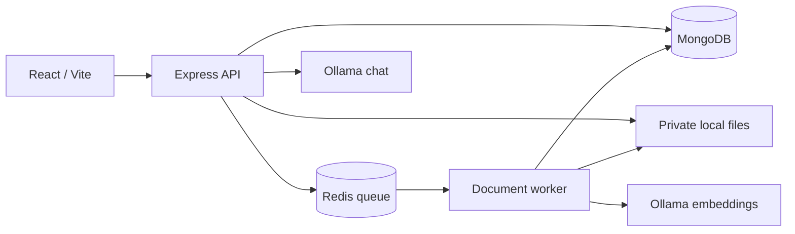

# DocShelf — AI Knowledge Workspace

DocShelf is a local-first prototype for organizing documents, asking questions with source references, and generating study quizzes. It is **not yet production-ready**. Read the [phase roadmap](docs/ROADMAP.md) and [progress and known limitations](docs/PROGRESS.md) before use.

## Local setup

Requirements: Node 22.13+ or 24+, MongoDB Community, Redis and Ollama. Start those services and pull the models:

```sh
# Qwen2.5 3B Instruct is subject to the Qwen Research License; review it before use.
ollama pull qwen2.5:3b
ollama pull all-minilm
cp .env.example .env
# Set JWT_SECRET to a random string of at least 32 characters.
npm install
npm run dev
```

Open http://localhost:5173. Vite proxies `/api` to the API on port 4000. The worker, MongoDB, Redis and Ollama must be running for ingestion and chat. Files are stored in `storage/`. Uploads are limited to 10 MB; processing supports up to 500 PDF pages and 1,000,000 extracted characters. DOCX archives are checked in the worker for required parts, at most 1,000 entries, a 20 MB per-entry limit and a 40 MB total expanded limit. Word files have document-level sources because DOCX does not store reliable rendered page numbers; the original file downloads instead of opening in the built-in PDF/text preview. Run the processes separately with `npm run dev -w @cortex/web`, `npm run dev -w @cortex/api`, and `npm run worker -w @cortex/api`.

With Docker available, `docker compose up -d mongo redis` starts the data services. Alternatively, after setting `JWT_SECRET` in `.env`, `docker compose --profile app up --build` starts the app at http://localhost:8080. Ollama remains on the host; configure it to accept connections from the containers. The Compose path has not been tested here. Its local HTTP cookie configuration is unsuitable for public deployment; use HTTPS and secure cookies in production.

## Demo

1. Create an account and upload a small PDF, Word (.docx), text, or Markdown file.
2. Wait for processing to finish. If it fails, check the worker and Ollama, then use Retry.
3. Ask a question in AI workspace. Open a cited or retrieved source to view its document page. A retrieved source is context, not proof that every answer claim is supported.
4. Create a collection, add a document, or generate a quiz from a ready document.

## Architecture



The worker stores page-associated chunks and embeddings for PDFs, and document-level chunks for Word and text files. The API computes cosine similarity over up to 5,000 owner-scoped chunks: a local baseline, **not a scalable vector index**. For cloud deployment replace it with an indexed vector service and shared object storage, and validate inference capacity controls. Chat/study generation and embeddings use separate Redis-backed shared leases. Replicating the API does not increase one Ollama instance's throughput. See [architecture](docs/ARCHITECTURE.md), [case study](docs/CASE-STUDY.md), [demo walkthrough](docs/DEMO.md) and [accessibility status](docs/ACCESSIBILITY.md).

## API

The [OpenAPI specification](docs/openapi.json) can be checked with `npm run check:api`. It is a prototype contract and still needs expanded response schemas and automated API contract tests.

Private routes require `Authorization: Bearer <token>`. Auth refresh/logout use an HttpOnly cookie and enforce the configured origin. Chat returns newline-delimited JSON events (`delta`, `done`, or `error`).

| Method | Path | Purpose |
|---|---|---|
| GET | `/api/v1/health`, `/api/v1/ready` | Liveness and dependency readiness |
| POST | `/api/v1/auth/signup`, `/signin`, `/refresh`, `/logout` | Account and session operations |
| GET/POST | `/api/v1/documents` | List or multipart `file` upload |
| GET/DELETE | `/api/v1/documents/:id/file`, `/api/v1/documents/:id` | Preview or delete an owned file |
| POST | `/api/v1/documents/:id/retry` | Requeue a failed document |
| GET/POST | `/api/v1/collections` | List or create collections |
| POST/DELETE | `/api/v1/collections/:id/documents`, `/api/v1/collections/:id` | Add a document or delete a collection |
| POST | `/api/v1/chat` | Stream answer to `{question, documentIds?, previousQuestion?}`; use `previousQuestion` for formatting follow-ups |
| POST | `/api/v1/search` | Search owned ready documents with `{query}` |
| GET/POST/DELETE | `/api/v1/study`, `/api/v1/study/:id` | List, generate, or delete summaries and flashcards |
| GET | `/api/v1/usage` | Owner-scoped storage and activity counts |
| GET/POST | `/api/v1/quizzes` | List or generate quiz with `{documentId}` |
| GET | `/api/v1/conversations` | List saved conversations |

## Checks

Run `npm run check:api`, `npm run typecheck`, `npm test`, and `npm run build`. Run `npm run evaluate:retrieval` for the small local embedding smoke evaluation. For an end-to-end real-model test, start dedicated disposable MongoDB and Redis services, set `TEST_MONGODB_URI` and `TEST_REDIS_URL`, and run `npm run evaluate:rag`. It creates a fictional three-page PDF and text note, exercises upload, page retrieval, chat, summary, flashcards and quiz, and deletes its uploaded documents. See [EVALUATION.md](docs/EVALUATION.md). To run the integration smoke test, start dedicated disposable MongoDB and Redis instances, then set `TEST_MONGODB_URI` and `TEST_REDIS_URL` and run `node scripts/integration.mjs`. The test starts a stub model, API and worker; to use local Ollama instead, set `TEST_OLLAMA_URL` to its URL (optionally set `TEST_EMBED_ONLY=1` to skip chat); it creates test accounts and queue entries in those instances, so do not point it at real data. These checks do not establish complete correctness or security.

Optionally set `CORTEX_SCANNER` to an absolute path to a scanner executable. The worker passes it the private file path as one argument; exit 0 permits processing and any other exit or timeout rejects it. No scanner is bundled or enabled by default. See [progress](docs/PROGRESS.md) for what was actually verified and the dependency advisory.

## Optional scaling checks

The Compose setup includes local API health checks and can be started with two API containers:

```sh
docker compose --profile app up --build --scale api=2
node scripts/check-distribution.mjs
# Optional, with k6 installed: k6 run tests/load/api.js
```

This Docker/Nginx workflow has not been verified in the authoring environment. Nginx uses passive upstream failure handling, not active health checks; DNS changes after startup may require a proxy restart. Docker volumes here are local to one host and are not a multi-host shared-storage solution. The load script uses a lightweight health endpoint; it does not measure AI throughput. Instance identifiers are enabled only for this local Compose demonstration.

For an isolated local smoke test without Docker, use dedicated disposable MongoDB and Redis services and run `TEST_PROXY=node TEST_MONGODB_URI=... TEST_REDIS_URL=... node scripts/proxy-smoke.mjs` after `npm run build`. This uses a small Node demonstration proxy for health requests; it is not the Nginx deployment and is not intended for production. With a usable Nginx binary, set `NGINX_BIN` instead of `TEST_PROXY=node` to test Nginx; that mode could not be run in the authoring sandbox.

Chat generation and embedding calls use separate Redis-backed concurrency pools. Embedding calls from API instances and workers share one pool, configured by `EMBEDDING_CONCURRENCY`; generation uses `AI_CONCURRENCY`. The two pools can still overlap, and a single local Ollama process remains the bottleneck. These leases are admission controls, not a guarantee of high availability.
