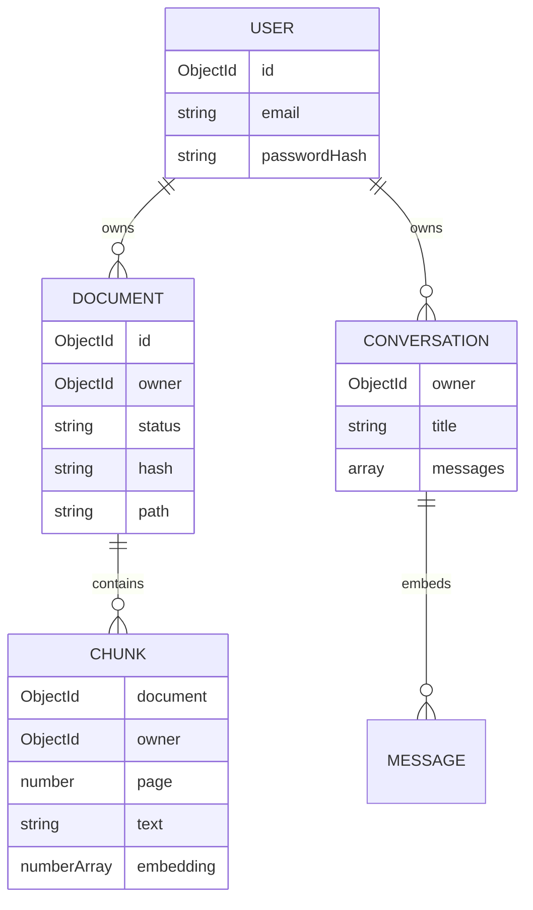

# Discovery and architecture

## Product and MVP

DocShelf helps an individual bring private documents together and ask grounded questions. The MVP is account access, upload and processing status, owned-document library, retrieval and chat with source references, and graceful model failure. Collections, full PDF viewer, page navigation, summaries, quizzes, flashcards, usage analytics, flashcards, full workspace membership, and semantic search UI are subsequent milestones. The design is dark-first with restrained violet accents, layered surfaces, a quiet sidebar, clear hierarchy, responsive layout and a light theme.

## Stack and decisions

React, Vite, TypeScript, Tailwind, Motion and Lucide provide a small modern frontend. Express is chosen for its mature ecosystem and simple middleware model. MongoDB follows the direct user request; its document records hold page chunks and vectors for the initial local baseline. Redis and BullMQ separate processing from API requests. Ollama runs Qwen 2.5 3B and all-MiniLM locally without a paid API. A dedicated vector database and provider interfaces remain future work. The direct user request for MongoDB takes precedence over the attachment's PostgreSQL recommendation. The specific Qwen2.5 3B Instruct distribution used here is under the [Qwen Research License](https://huggingface.co/Qwen/Qwen2.5-3B-Instruct/blob/main/LICENSE), not Apache 2.0; the earlier claim was incorrect. all-MiniLM-L6-v2 is Apache 2.0. Review the precise model license before distribution or deployment.

## Data model

Planned: workspace membership, collections, workspace membership, audit events and usage records. Add unique owner/hash index and transactional lifecycle management before production.

## Retrieval flow

Upload → signature check → private file and metadata → BullMQ job → page extraction → overlapping chunks → Ollama embedding → owner-scoped chunk storage. Question → query embedding → owner-filtered cosine ranking → bounded context → Ollama answer → references and conversation persistence. Sources returned are retrieved excerpts, not independently verified claims; inspect them before reliance. PDF text extraction may fail for scans; OCR is not implemented.

## Threat model and scale

Assets include passwords, private documents and conversations. Trust boundaries are browser/API, API/queue, worker/files and model/context. Existing controls include bcrypt, bearer authentication, ownership filters, signature checks, size limits, restricted CORS, Helmet, validation, Redis-backed rate limits and a prompt treating excerpts as untrusted. Prompt injection remains possible; model instructions are not a security boundary. Missing controls are listed in progress. Before public use, harden and test refresh-token revocation, validate distributed rate limiting, streaming upload and malware scanning, secure shared storage, quotas, audit events, access tests, deletion/job race handling, index-backed retrieval, AI concurrency limits and full operational monitoring. TLS, managed secrets, replica health routing and shared data services are mandatory in a hosted environment.

## Hardware and milestones

An M2/8 GB machine can run the web app, API, worker, MongoDB, Redis and one quantized 3B model for small documents, but memory pressure and latency will vary considerably. Ollama's embedding model and chat model may compete for RAM; unload or run selectively if memory is tight. Docker adds overhead; avoid running browser tests, a full monitoring stack and additional model instances simultaneously. No throughput or memory measurements have been made. Milestones: (1) verify this slice with real services, (2) harden ingestion and identity, (3) implement streaming and viewer, (4) add collections/quiz features, (5) run integration, security, accessibility and performance tests, (6) measure a multi-replica deployment.
